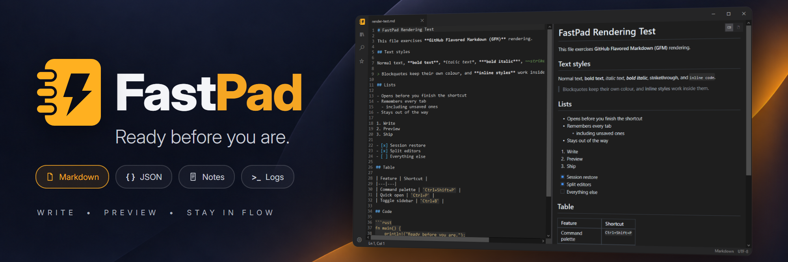
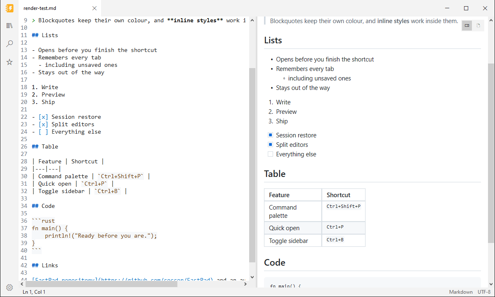
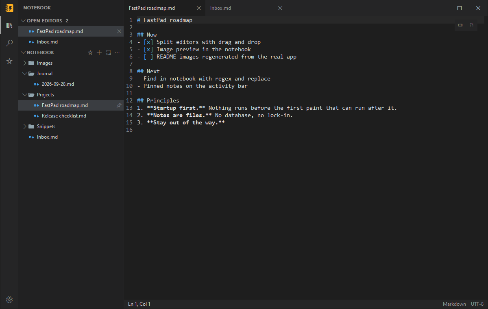
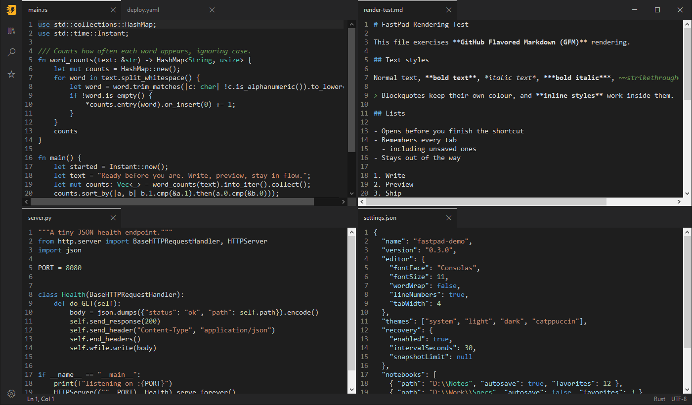
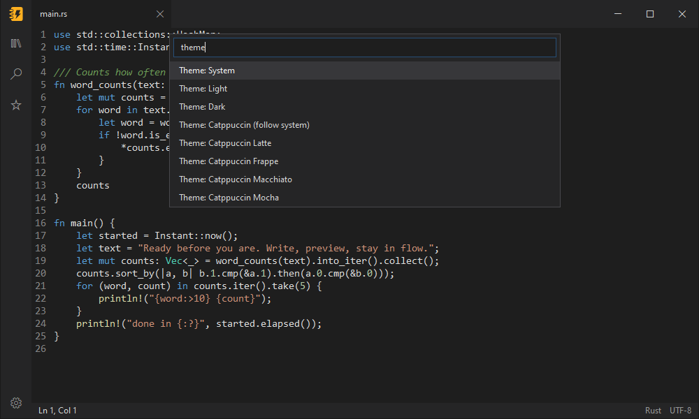
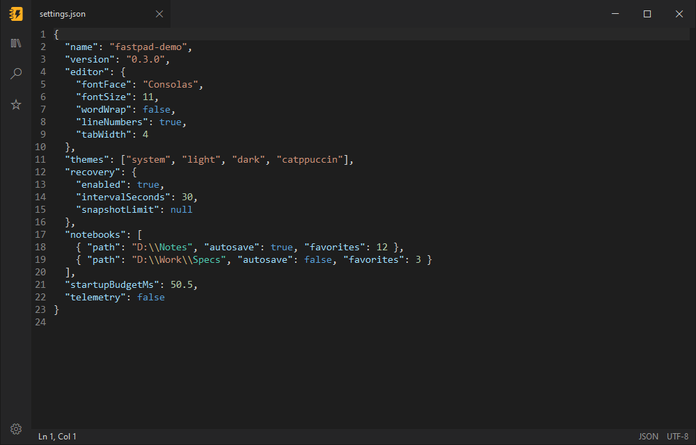
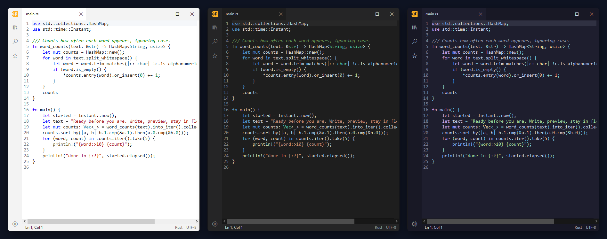

<div align="center">


# FastPad

**The text editor that's ready before you are.**

A native Windows editor and notebook, written in Rust on Win32 and built on Scintilla.

[](https://github.com/coccor/FastPad/releases/latest)
[](LICENSE)

[](https://github.com/coccor/FastPad/releases)

[**Download**](https://github.com/coccor/FastPad/releases/latest) · [Features](docs/features.md) · [Shortcuts & settings](docs/reference.md) · [How it's built](docs/how-its-built.md)



</div>

## Why FastPad

| | |
|---|---|
| ⚡ **~60 ms to typing** | The window takes your keystrokes first; everything else loads behind you. ([How we measure](benchmarks/README.md)) |
| 🪶 **Under 3 MB idle, 5 MB download** | One executable and two DLLs. No runtime, no framework, no Electron. |
| 🔒 **Offline by design** | No network access, no telemetry, no account. |
| 💾 **Never lose a word** | Unsaved work is snapshotted as you type and survives crashes and power cuts. |

## Install

```powershell
winget install coccor.FastPad
```

Also available via **Scoop**, an **installer**, or a **portable ZIP** from the
[latest release](https://github.com/coccor/FastPad/releases/latest). See [all install options](docs/install.md).

> [!NOTE]
> Releases aren't code-signed yet, so SmartScreen may warn on first run. Choose
> **More info > Run anyway**, or verify the file against `SHA256SUMS.txt`.

## Features

<table>
<tr>
<td width="50%" valign="top">
<br>
<b>Markdown, live</b><br>
Source, split, preview or a live view that renders as you type. Mermaid diagrams, tables and task lists included.
</td>
<td width="50%" valign="top">
<br>
<b>Notes and notebooks</b><br>
Any folder becomes a notebook. Plain files, <code>[[wikilinks]]</code>, <code>#tags</code>, backlinks and daily notes.
</td>
</tr>
<tr>
<td width="50%" valign="top">
<br>
<b>Split editors</b><br>
Any grid of rows and columns. Drag tabs between groups; the layout comes back with your session.
</td>
<td width="50%" valign="top">
<br>
<b>Command palette</b><br>
Every command and setting, a few keystrokes away.
</td>
</tr>
<tr>
<td width="50%" valign="top">
<br>
<b>JSON and 20+ languages</b><br>
Validate and format JSON; highlighting for Rust, Python, C#, YAML, PowerShell and more.
</td>
<td width="50%" valign="top">
<br>
<b>Themes</b><br>
Light, dark, system, Catppuccin and Paper/Lamp, with day/night switching.
</td>
</tr>
</table>

**And also:** quick capture from anywhere (`Ctrl+Alt+N`) · paste screenshots straight into notes ·
picks up changes made by other programs or AI agents · session restore · image and SVG preview ·
encodings preserved · safe atomic saves.

→ **[Read the full feature guide](docs/features.md)**

## Essential shortcuts

| | | | |
|---|---|---|---|
| Command palette | `Ctrl+Shift+P` | Go to note | `Ctrl+P` |
| Search notes | `Ctrl+Shift+F` | Quick capture | `Ctrl+Alt+N` |
| Markdown view | `Ctrl+Shift+V` | Today's note | `Ctrl+Alt+D` |
| Split editor | `Ctrl+\` | Settings | `Ctrl+,` |

All shortcuts, every `fastpad.ini` setting and command-line options are in the [reference](docs/reference.md).

## FAQ

**Is it free?** Yes: MIT-licensed, no paid tier, no ads, no data collection.

**Does it replace Notepad?** It sits alongside it. FastPad joins "Open with" without changing your defaults.

**ARM or 32-bit Windows?** Not yet. Current builds are Windows 10 and 11 x64.

## Building from source

Requires Rust stable, Visual Studio 2022 C++ x64 build tools and PowerShell 7.

```powershell
pwsh -File tools/fetch-native.ps1     # download and verify Scintilla and Lexilla
pwsh -File tools/build-native.ps1     # build the DLLs into native\out\x64
cargo build --release
cargo test -- --test-threads=1        # integration tests must run serially
```

Packaging, releasing and signing: [`docs/distribution.md`](docs/distribution.md). Benchmarks: [`benchmarks/README.md`](benchmarks/README.md).

## Contributing & license

Found a bug? [Open an issue](https://github.com/coccor/FastPad/issues). If FastPad saves you time,
**[star it on GitHub](https://github.com/coccor/FastPad)**.

Released under the [MIT License](LICENSE). Third-party licenses are in [`LICENSES.md`](LICENSES.md).
