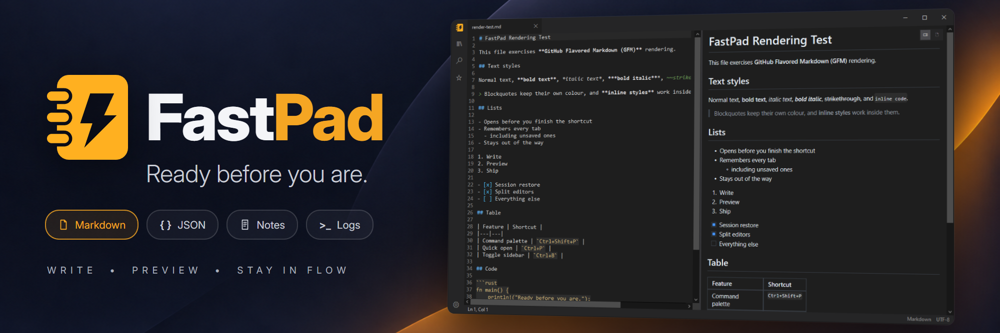
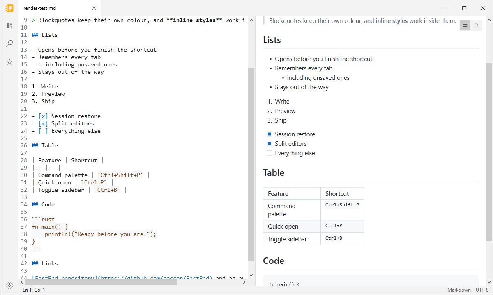
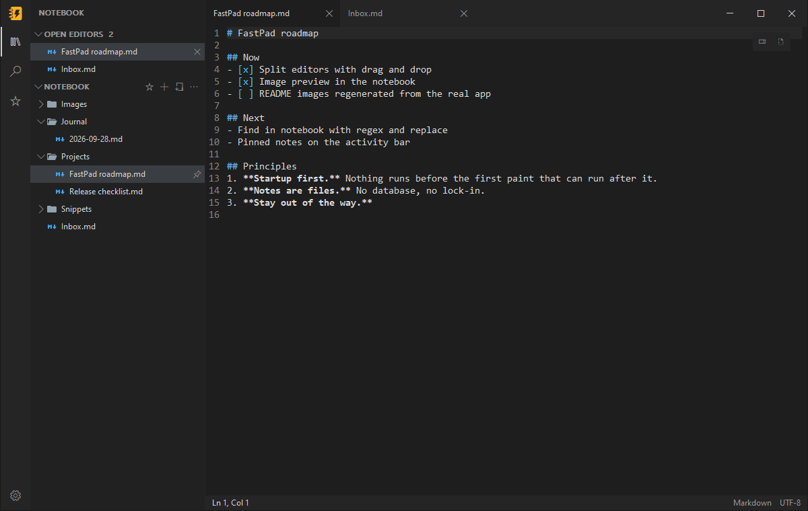
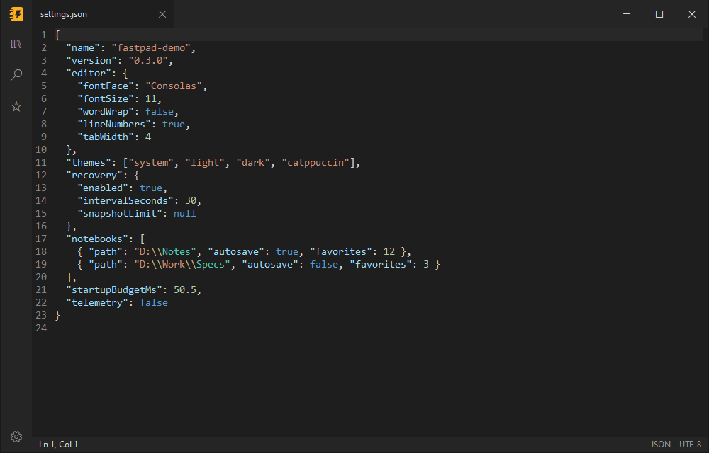
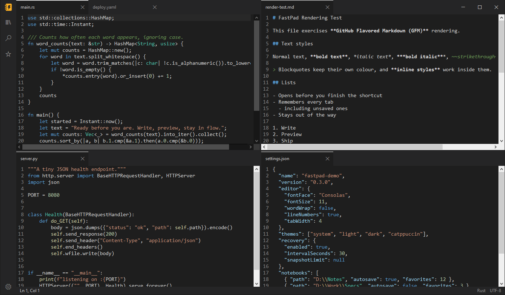
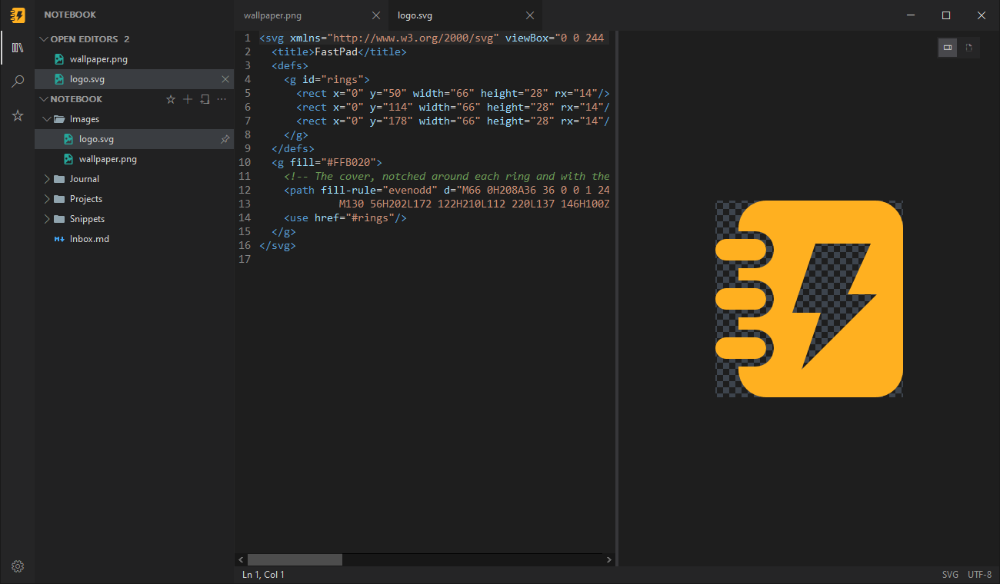
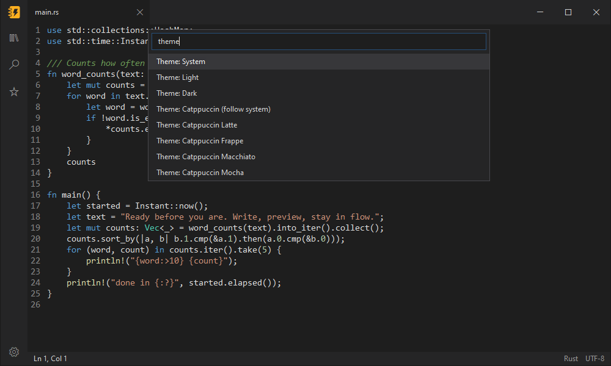
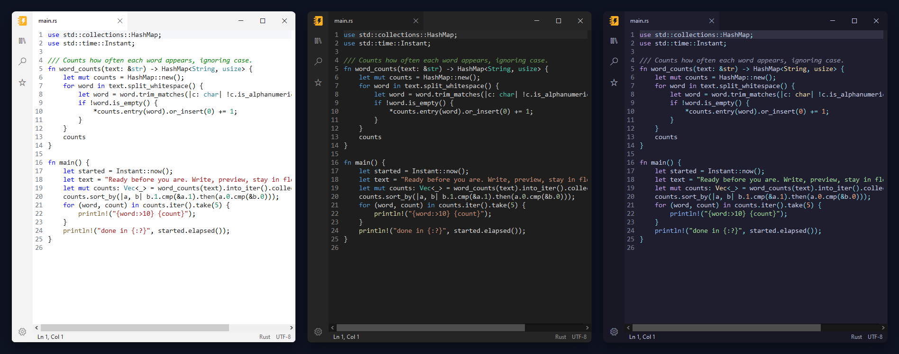

<div align="center">


# FastPad

**The text editor that's ready before you are.**

Click it, type. No splash screen, no spinner, no "loading extensions".
A native Windows editor for the notes, logs, configs, JSON and Markdown you open fifty times a day.

[](https://github.com/coccor/FastPad/releases/latest)
[](LICENSE)

[](https://github.com/coccor/FastPad/releases)

[**Download**](https://github.com/coccor/FastPad/releases/latest) · [Install](#install-in-10-seconds) · [Features](#everything-you-reach-for-nothing-you-dont) · [Shortcuts](#keyboard-shortcuts)



</div>

## Why FastPad

Most editors make you wait for everything before you can do anything. FastPad turns that around:
the window takes your keystrokes first, and settings, file loading, syntax highlighting and crash
recovery catch up behind you.

- **Typing in about 60 ms.** From launch to your first character on screen, measured over repeated
  warm launches on a 2014 Intel Core i5-4590 desktop ([how we measure](benchmarks/README.md)).
- **About 2 MB of memory at idle.** Leave it open all day and forget it's there.
- **A 1.7 MB download.** One executable and two DLLs. No runtime, no framework, no Electron.
- **Your text never leaves your PC.** No network access, no telemetry, no account, no background
  service. Links you click open in your browser; nothing else goes online.
- **Never lose a word.** Unsaved work is snapshotted while you type and comes back after a crash or
  power cut.

Written in Rust directly on Win32, with the battle-tested
[Scintilla](https://www.scintilla.org/) editing engine underneath.

## Install in 10 seconds

```powershell
winget install coccor.FastPad
```

<details>
<summary><b>Other ways to install</b>: Scoop, installer, portable ZIP</summary>

| Method | How | What you get |
|---|---|---|
| **winget** | `winget install coccor.FastPad` | Per-user install; `winget upgrade` keeps it current |
| **Scoop** | `scoop bucket add fastpad https://github.com/coccor/FastPad`<br>`scoop install fastpad/fastpad` | Portable install, Start menu shortcut, `fastpad` command |
| **Installer** | [`FastPad-<version>-windows-x64-setup.exe`](https://github.com/coccor/FastPad/releases/latest) | Per-user install, no administrator prompt |
| **Portable** | [`FastPad-<version>-windows-x64.zip`](https://github.com/coccor/FastPad/releases/latest) | Extract anywhere, run `FastPad.exe`; nothing written to the registry |

Every release publishes `SHA256SUMS.txt` so you can verify what you downloaded.

**The installer** puts FastPad in `%LocalAppData%\Programs\FastPad` and only touches your own user
registry: an uninstall entry, a Start menu shortcut, `fastpad` for Win+R, and FastPad in the
"Open with" list for `.txt`, `.md`, `.markdown`, `.json`, `.log` and `.ini`. Your default apps are
never changed. Optional extras: a desktop shortcut and "Edit with FastPad" on every file's right-click
menu. Uninstall from Settings > Apps. Unattended install:

```powershell
FastPad-<version>-windows-x64-setup.exe /VERYSILENT /SUPPRESSMSGBOXES /TASKS="contextmenu"
```

`/ALLUSERS` installs for every user into Program Files instead (requires elevation).

**The portable ZIP** holds `FastPad.exe`, `Scintilla.dll` and `Lexilla.dll` (keep them together),
plus `README.md`, `LICENSE`, `LICENSES.md` and `licenses\`.

Settings and recovery snapshots live in `%LocalAppData%\FastPad` whichever way you install, so you
can switch methods without losing them, and uninstalling keeps them.

</details>

> **"Windows protected your PC"?** Current releases aren't code-signed yet, so SmartScreen may warn
> on first run. Choose **More info > Run anyway**, or check the file against `SHA256SUMS.txt` first.

## Everything you reach for. Nothing you don't.

### Markdown with a live preview



Write on the left, see it rendered on the right. FastPad draws GitHub-flavored Markdown natively
(tables, task lists, strikethrough, code blocks and local images) and updates moments after you stop
typing. Both panes scroll together.

- Show the preview side by side or full width, and drag the divider to resize it.
- Links just work: web links open in your browser, `#headings` jump inside the preview, and links to
  local files open in a new FastPad tab.
- Privacy by design: only local images are shown, and nothing is fetched from the internet.
- The preview's graphics stack loads the first time you open a preview, so it never slows startup.
- Writing helpers in Markdown files: `Ctrl+B`, `Ctrl+I`, ``Ctrl+` `` and `Ctrl+K` make the selection
  bold, italic, code or a link. Enter continues a list (Enter on an empty item ends it), Tab and
  Shift+Tab nest list items and move between table cells, and a table lines up when you leave it.
  Each is a single undo step.
- **Live Markdown (preview):** `Ctrl+Alt+V`, or View → Live Markdown, switches a Markdown tab to a
  new view FastPad draws itself, in the preview's font with real wrapping. Typing, selecting, undo,
  find, the writing helpers and Japanese, Chinese or Korean input work as in the source view, and the
  file is only ever changed by what you type. This first release shows the text as plain prose;
  rendered headings, emphasis, lists, tables and images follow in the next releases. Set
  `markdown_live_default=true` to open Markdown tabs in it.

### Notes and notebooks



Open any folder and it becomes your notebook: a tree in the sidebar, folders as they are on disk,
pinned notes first. Notes are plain files, so nothing is locked in.

- **Write fast.** New notes are named inline and save themselves once they're in the notebook.
  Create, rename, move (drag and drop) and delete notes and folders right in the tree.
- **Find anything.** Search and replace across every note, with case, whole-word and regex
  options, and jump to any note by typing part of its name. Nothing is indexed; results stream in.
- **Open Editors** lists every open tab above the tree. Drag files in from Explorer or from Open
  Editors to copy them into the notebook.
- Star notebooks to keep them in **Favorites**, pick coloured, minimal or solid file icons, and
  drive it all from the keyboard or a screen reader.

Pins travel with the notebook in `.fastpad\library.ini`, and nothing is written into a folder until
you pin something. Turn notes off with `notes_mode=false` in `fastpad.ini`.

### Tags and front matter

Tag a note with `#tags` anywhere in its text, or in its YAML front matter:

```markdown
---
tags: [project/atlas, todo]
status: active
---
Call Dana about the #budget.
```

- **The Tags view** (the tag button in the activity bar, or **View: Show tags**) lists every tag
  in the notebook with how many notes use it. Nested tags like `#project/atlas` sit under
  `#project`. Expand a tag to see its notes; click one to open it.
- **In the preview**, front matter shows as a table of its properties, and each `#tag` is a chip
  you can click to see the tag's notes.
- Tags in code, links and HTML don't count, and neither do `#123` or `C#`.

FastPad keeps an index of every Markdown note's tags and front matter, updated as notes are saved
or changed outside FastPad, and cached so the next start reads only what changed.

### Links between notes

Link to another note by name with `[[wikilinks]]`, as Obsidian does:

```markdown
See [[Project Atlas]], its [[Project Atlas#Goals|goals]], or [[work/Plan]].
```

- **Type `[[`** and FastPad offers the notebook's notes; keep typing to narrow the list.
- **Follow a link** with `Ctrl+Click` or `F12` in the editor, or a click in the preview. A link to
  a note that doesn't exist yet creates it.
- A name finds a note by its file name, its path, or an `aliases:` entry in its front matter.
  When two notes share a name, the one in the linking note's folder wins.
- **The Links view** (the link button in the activity bar, or **View: Show links**) shows which
  notes link to the active note, with the line that mentions it, and what the note links to.
  It also lists **missing notes** (linked but not yet written) and notes nothing links to.
- **Rename or move a note** in FastPad and its relative links are fixed, and FastPad offers to
  update the links in other notes. Renaming can keep the old name as an alias. When another
  program renames a note, a notice says which links still use the old name, and
  **Notes: Update links to renamed notes** fixes them.

### Images and files in notes

In a Markdown note, **paste a screenshot** (`Ctrl+V`) or files copied in Explorer, or **drop files
with `Ctrl` held**, and FastPad copies them into the notebook's `attachments` folder (or the one
your Obsidian vault uses) and links them where the caret is: `` for images,
`[name](…)` for other files. **Notes: Insert attachment…** picks a file instead.

- When the clipboard has text too (a paragraph copied from Word puts a picture there as well),
  `Ctrl+V` pastes the text. **Notes: Paste image as attachment** takes the image anyway.
- A Markdown file outside the notebook keeps its attachments in an `attachments` folder beside it.
- Move a note and its links to images and files keep working. Move an image in the Notebook tree
  and FastPad offers to update the notes that show it.

### Daily notes and templates

- **`Ctrl+Alt+D`** (Notes: Open today's note) opens today's note in `journal\`, making it the
  first time from `.fastpad\templates\daily.md`, or with the date as its heading.
  **Notes: Previous daily note** and **Next daily note** step through the journal.
- **Notes: New note from template…** (also in the Notebook `…` menu and a folder's right-click
  menu) lists the templates in `.fastpad\templates` and makes a new note from the one you pick.
- Templates fill in `{{date}}`, `{{date:dddd, D MMMM YYYY}}`, `{{time}}` and `{{title}}`, and the
  caret starts at `{{cursor}}`. Placeholders work in front matter too.
- A notebook's conventions live in `.fastpad\notebook.ini`, which other tools and AI agents can
  read too. **Notes: Edit notebook settings** opens it:

```ini
daily_folder=journal
daily_format=YYYY-MM-DD
daily_template=.fastpad/templates/daily.md
templates_folder=.fastpad/templates
inbox=inbox.md
```

### Quick capture

Press **`Ctrl+Alt+N`** anywhere to jot something down without leaving what you're doing. The
capture box appends it to your notebook's `inbox.md` as a time-stamped list item.

- **`Ctrl+Enter`** saves and closes; **`Ctrl+Shift+Enter`** also opens the note. **`Esc`** closes
  and keeps what you typed for next time.
- **Images and files:** paste a screenshot or files copied in Explorer, drop files on the box, or
  press **`Ctrl+Shift+S`** to snip part of the screen with Windows' own tool. They are copied into
  the notebook's `attachments` folder and linked from the capture.
- **`Ctrl+Alt+N`** again in the box switches where this capture goes: the inbox, today's daily
  note, or a new file of its own in `inbox`, which suits AI agents that process items one by one.
  `capture_target` in `notebook.ini` sets the default.
- It works when FastPad isn't running too: the installer's "Quick capture shortcut" option sets
  up the same key, and `FastPad.exe --capture "text"` captures from scripts.

### Changes made outside FastPad

Edit a file in another program, sync it from another PC, or let an AI agent work on your notes:
FastPad keeps up while it's open.

- **Open tabs follow the file.** A tab with no unsaved edits picks up the new text as soon as
  the file changes, as one edit you can undo: **Ctrl+Z** brings back what you had.
- **Appends join your edits.** Text added to the end of a file you're editing (a log, an inbox)
  is added to the end of your tab, with nothing to resolve.
- **Real conflicts wait for you.** Any other change to a tab with unsaved edits shows a warning in
  the tab and pauses autosave. Use **Note: Reload from disk**, **Note: Keep my version**, or
  **Note: Compare with disk** to see the file's version read-only beside yours.
- **A deleted file keeps its tab**, marked "(deleted)". Saving creates it again.
- **The notebook shows what changed.** A dot marks each note changed outside FastPad since you
  last opened it, and it survives a restart. **Notes: Show changed notes** lists only those;
  **Notes: Clear changed marks** clears them.

The open notebook is watched for changes as they happen, and other open files are checked when
FastPad comes back to the front. Changes inside folders such as `.git` and `node_modules` are
ignored. To have every change wait for you instead, set `reload_changed_files=ask`.

### JSON you can trust



Syntax highlighting as soon as you open a `.json` file. **Validate JSON** points to the exact line
and column of a mistake; **Format JSON** pretty-prints the whole document in one step you can undo. Neither will
touch a file that doesn't parse.

### Syntax highlighting for the files you actually open

FastPad picks the language from the file name and colours it in every theme: JSON, Markdown, XML
(including SVG, `.csproj` and `.xaml`), HTML, CSS, JavaScript, TypeScript, YAML, TOML, INI,
`.properties`, `.env`, PowerShell, Bash, Batch, Python, C, C++, C#, Rust and SQL. Switch it by hand
from **View → Language** or the command palette. The notebook lists all of these files too
(`.env`, `.bashrc` and `Cargo.lock` included), each with its own icon in every icon set.

### Tabs, done right

Open as many files as you like in one window. Every tab keeps its caret and scroll position, across
switches and restarts. Open a file from Explorer or the command line and it lands as a tab in the
FastPad window you already have open, not in a new window.

### Split editors



Put files side by side in any grid of rows and columns. Drag a tab onto another group to move it,
or onto an editor's edge to split it. Each group has its own tabs, and the layout comes back with
your session.

### Images next to your notes



PNG, JPEG, GIF, WebP and more open in an image tab you can zoom and pan. SVGs open as text, with
their rendered preview beside the source. The notebook lists images next to your notes.

### A command palette for everything



Open it and start typing. Switch theme, toggle word wrap or line numbers, change font size
or tab width, all without leaving the keyboard. Every change is saved instantly. Prefer to
see everything at once? **Settings** (`Ctrl+,`, **File > Settings...** or the gear at the
bottom of the sidebar) lists every setting, and changes apply as you make them.

### Themes that match your desk



Light, dark, or **System** to follow Windows as it switches. Plus all four
[Catppuccin](https://catppuccin.com/) flavors (Latte, Frappé, Macchiato, Mocha), or plain
`catppuccin` to pick Latte by day and Mocha by night. For long reading and writing sessions there are
**Paper** (warm off-white) and **Lamp** (warm charcoal), or `paper-lamp` to pick Paper by day and Lamp by
night. Windows high contrast is always respected.

### Crash recovery that just works

FastPad quietly snapshots unsaved documents every 30 seconds while you edit. If your PC crashes,
loses power or reboots for an update, the next launch brings your work back as unsaved tabs. Saving
or discarding a recovered tab cleans up after itself.

### Pick up where you left off

Close FastPad and the next launch reopens every tab, including unsaved edits and untitled notes,
with the tab you were on active. Closing never nags about unsaved changes while this is on. Turn
it off with **File > Restore session on startup** or `restore_session=false`, and FastPad asks
before closing again.

### And the details you'd expect

- **Safe saves.** Files are written to a temporary copy and swapped into place, so a failed save never
  leaves you with a half-written file.
- **Encodings preserved.** UTF-8, UTF-8 with BOM, UTF-16 LE and UTF-16 BE are detected on open and
  kept on save.
- **Find and replace** with match case, whole word and regular expressions, plus zoom, word wrap
  and line numbers.
- **Code folding.** Collapse and expand blocks from the margin, or with Fold All and Unfold All in
  the command palette. Turn it off in Settings.
- **Screen-reader friendly links.** Links in the Markdown preview are exposed to assistive
  technology and can be followed from it.

## Keyboard shortcuts

| Action | Shortcut | | Action | Shortcut |
|---|---|---|---|---|
| New tab | `Ctrl+N` or `Ctrl+T` | | Command palette | `Ctrl+Shift+P` |
| Open | `Ctrl+O` | | Markdown preview modes | `Ctrl+Shift+V` |
| Save | `Ctrl+S` | | Format JSON | `Shift+Alt+F` |
| Save as | `Ctrl+Shift+S` | | Word wrap | `Alt+Z` |
| Find | `Ctrl+F` | | Zoom in / out / reset | `Ctrl++` / `Ctrl+-` / `Ctrl+0` |
| Replace | `Ctrl+H` | | Next / previous tab | `Ctrl+Tab` / `Ctrl+Shift+Tab` |
| Undo / redo | `Ctrl+Z` / `Ctrl+Y` | | Go to tab 1–9 | `Alt+1` … `Alt+9` |
| Open notebook | `Ctrl+Shift+O` | | Toggle sidebar | `Ctrl+B` (Bold in Markdown files) |
| Show notebook | `Ctrl+Shift+E` | | Search notes | `Ctrl+Shift+F` |
| Move note to notebook | `Ctrl+Shift+M` | | Sidebar / editor groups focus | `F6` / `Shift+F6` |
| Find next / previous | `F3` / `Shift+F3` | | Match case / whole word / regex | `Alt+C` / `Alt+W` / `Alt+R` |
| Replace in notes | `Ctrl+Shift+H` | | Replace all (in Search) | `Ctrl+Alt+Enter` |
| Replace in the selected result | `Ctrl+Shift+1` | | Go to note | `Ctrl+P` |
| Close tab | `Ctrl+W` or middle-click | | Split editor right / down | `Ctrl+\` / `Ctrl+Shift+\` |
| Focus editor group 1–8 / last | `Ctrl+1` … `Ctrl+8` / `Ctrl+9` | | Move tab to next / previous group | `Ctrl+Alt+Right` / `Ctrl+Alt+Left` |
| Settings | `Ctrl+,` | | Select line | `Ctrl+L` |
| Move line up / down | `Alt+Up` / `Alt+Down` | | Copy line up / down | `Shift+Alt+Up` / `Shift+Alt+Down` |
| Delete line | `Ctrl+Shift+K` | | Insert line below / above | `Ctrl+Enter` / `Ctrl+Shift+Enter` |
| Indent / outdent line | `Ctrl+]` / `Ctrl+[` | | Toggle line / block comment | `Ctrl+/` / `Shift+Alt+A` |
| Add next occurrence | `Ctrl+D` | | Select all occurrences | `Ctrl+Shift+L` |
| Add cursor above / below | `Ctrl+Alt+Up` / `Ctrl+Alt+Down` | | Add cursor | `Alt+Click` |
| Bold / italic (Markdown files) | `Ctrl+B` / `Ctrl+I` | | Code / link (Markdown files) | ``Ctrl+` `` / `Ctrl+K` |
| Follow link at caret | `F12` or `Ctrl+Click` | | Today's note | `Ctrl+Alt+D` |
| Live Markdown | `Ctrl+Alt+V` | | | |

## Make it yours

Everything in the command palette or Settings is saved to `%LocalAppData%\FastPad\fastpad.ini`. You can also
edit it by hand: one `key=value` per line. A typo never blocks startup; FastPad points out the bad
line in a notification and applies the rest.

| Key | Values | Default |
|---|---|---|
| `font_face` | Any installed font name | `Consolas` |
| `preview_font` | Any installed font name, for Markdown preview text (code in the preview uses `font_face`) | `Segoe UI` |
| `preview_font_size` | Markdown preview text size in pixels (positive integer) | `14` |
| `preview_line_height` | Markdown preview line height, a multiple of the text size from `1.0` to `3.0` | `1.6` |
| `font_size` | Points (positive integer) | `11` |
| `tab_width` | 1–255 | `4` |
| `word_wrap` | `true`/`false`, `1`/`0`, `yes`/`no`, `on`/`off` | `false` |
| `line_numbers` | `true`/`false`, `1`/`0`, `yes`/`no`, `on`/`off` | `true` |
| `insert_spaces` | `true`/`false`, `1`/`0`, `yes`/`no`, `on`/`off` | `false` |
| `show_whitespace` | `true`/`false`, `1`/`0`, `yes`/`no`, `on`/`off` | `false` |
| `highlight_current_line` | `true`/`false`, `1`/`0`, `yes`/`no`, `on`/`off` | `true` |
| `code_folding` | `true`/`false`, `1`/`0`, `yes`/`no`, `on`/`off` | `true` |
| `always_on_top` | `true`/`false`, `1`/`0`, `yes`/`no`, `on`/`off` | `false` |
| `capture_hotkey` | A key like `Ctrl+Alt+N`; empty turns it off | `Ctrl+Alt+N` |
| `capture_source` | `true`/`false`: note the window you were in when you pressed the capture hotkey | `false` |
| `markdown_live_default` | `true`/`false`: open Markdown tabs in the Live Markdown view | `false` |
| `theme` | `system`, `light`, `dark`, `catppuccin`, `catppuccin-latte`, `catppuccin-frappe`, `catppuccin-macchiato`, `catppuccin-mocha`, `paper-lamp`, `paper`, `lamp` | `system` |
| `recovery_interval_seconds` | Seconds between recovery snapshots | `30` |
| `restore_session` | `true`/`false`, `1`/`0`, `yes`/`no`, `on`/`off` | `true` |
| `reload_changed_files` | `auto` (a tab without unsaved edits takes a file's outside changes by itself) or `ask` (every change waits for you) | `auto` |
| `sidebar_view` | `notebook`, `search`, `favorites`, `tags`, `none` | `notebook` |
| `sidebar_width` | 180–480 (pixels at 100% scaling) | `260` |
| `settings_size` | `<width>x<height>` (pixels at 100% scaling), saved when you resize Settings | none: its natural size |
| `window_placement` | `<x>,<y>,<width>x<height>`, then `,maximized` if it was; saved when the main window closes | none: opens at the default spot |
| `file_icons` | `material`, `minimal` or `solid` | `material` |

Hand edits keep your comments and other lines; the palette and Settings rewrite only the lines they change.

## Command line

```text
FastPad.exe [--new-window] [path]
FastPad.exe --capture ["text" | -] [--attach <file>]...
```

- `FastPad.exe notes.md` opens the file in your running FastPad window, or starts FastPad if none is
  open.
- `--new-window` always starts a separate, independent window.
- `--capture` opens the quick capture box. With text (or `-` to read it from standard input) and
  any `--attach` files, it files them into the inbox with no window and exits: `0` when filed, `1`
  when the write failed, `2` when the request was refused (a missing file, or one over 20 MB). It
  goes to your running FastPad when there is one.
- `--diagnostic` is for the startup benchmark harness; you don't need it.

## FAQ

**Is it really free?** Yes. FastPad is open source under the MIT License, with no paid tier, no ads
and no data collection.

**Does it replace Notepad?** It sits alongside it. The installer adds FastPad to "Open with" for
common text formats without taking over your defaults, and you can make it the default for any file
type from Windows Settings.

**Why the SmartScreen warning?** New, unsigned apps have no reputation with Microsoft yet. Code signing
is on the way; until then, every release publishes SHA-256 checksums you can verify.

**Can I use it on Windows on ARM or 32-bit Windows?** Not yet. Current builds are Windows 10 and 11
x64.

The preview renders GitHub-flavored Markdown natively (tables, task lists, strikethrough, code
blocks, images) and the HTML GitHub allows in READMEs: centred `<div>` and `<p>` blocks, sized
`` tags, `<picture>` images that follow the light or dark theme, collapsible
`<details>` sections, and inline tags such as `<kbd>`, `<sup>`, and `<br>`. Local PNG, JPEG, GIF,
and SVG images are shown; remote images show a placeholder with their alt text, because nothing is
loaded from the network. It updates shortly after you stop typing, and scrolling either pane scrolls
the other. Links open when clicked: web and mail links in your default browser, `#anchors` inside
the preview (opening any collapsed section around them), and local files in a FastPad tab.
Files larger than 10 MB pause live updates; click the bar at the top of the preview to refresh it.

If FastPad saves you a few seconds a day, **[star it on GitHub](https://github.com/coccor/FastPad)**.
It's the single best way to help others find it. Found a bug or missing something?
[Open an issue](https://github.com/coccor/FastPad/issues).

## Building from source

Requirements: Rust stable (see `rust-toolchain.toml`), Visual Studio 2022 with the C++ x64 build
tools, and PowerShell 7.

```powershell
pwsh -File tools/fetch-native.ps1           # download and SHA-256-verify Scintilla and Lexilla
pwsh -File tools/build-native.ps1           # build the DLLs into native\out\x64
cargo build --release
cargo test -- --test-threads=1              # Windows integration tests must run serially
pwsh -File tools/audit-dependencies.ps1     # allow only the windows-sys/serde_json closure
pwsh -File tools/package.ps1                # dist\FastPad-<version>-windows-x64.zip
pwsh -File tools/verify-package.ps1         # add -RequireSignature for signed release builds
pwsh -File tools/package-installer.ps1      # dist\FastPad-<version>-windows-x64-setup.exe (Inno Setup 6)
pwsh -File tools/verify-installer.ps1       # silent install, registration checks, uninstall
```

The version comes from `Cargo.toml`. Releasing, code signing, and the Scoop and winget manifests are
covered in [`docs/distribution.md`](docs/distribution.md); startup benchmarking in
[`benchmarks/README.md`](benchmarks/README.md).

## License

FastPad is released under the [MIT License](LICENSE). Scintilla, Lexilla and the Rust crates it
links are listed with their licenses in [`LICENSES.md`](LICENSES.md).
