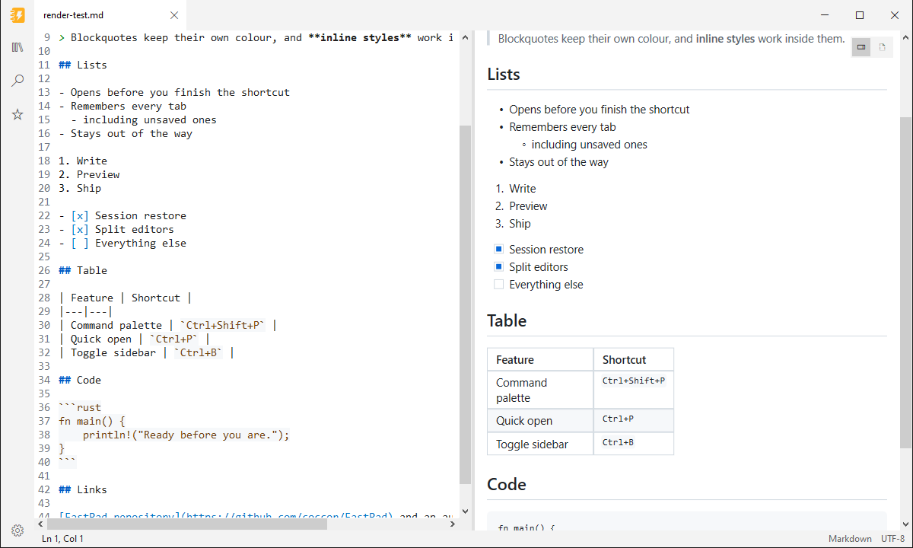
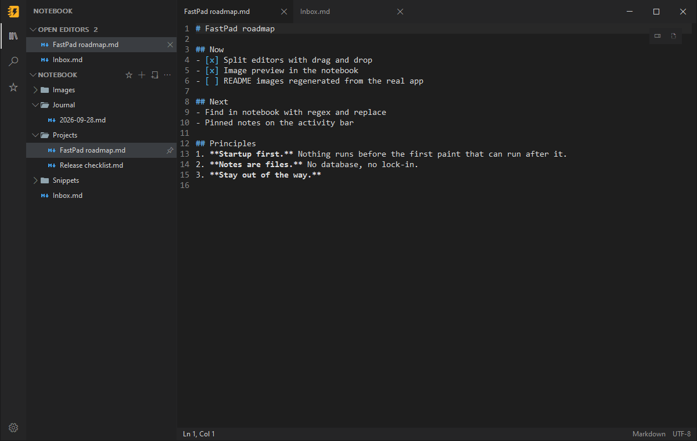
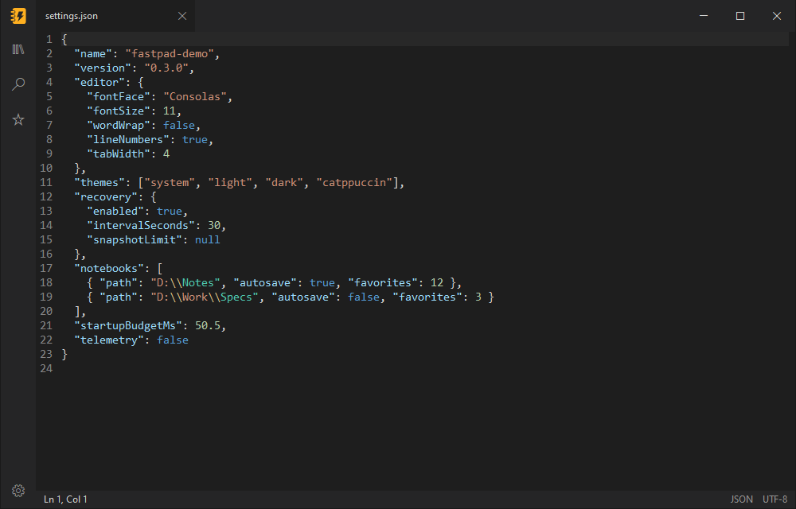
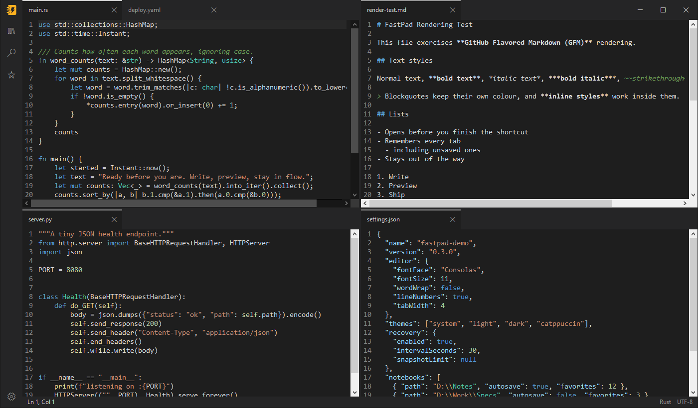
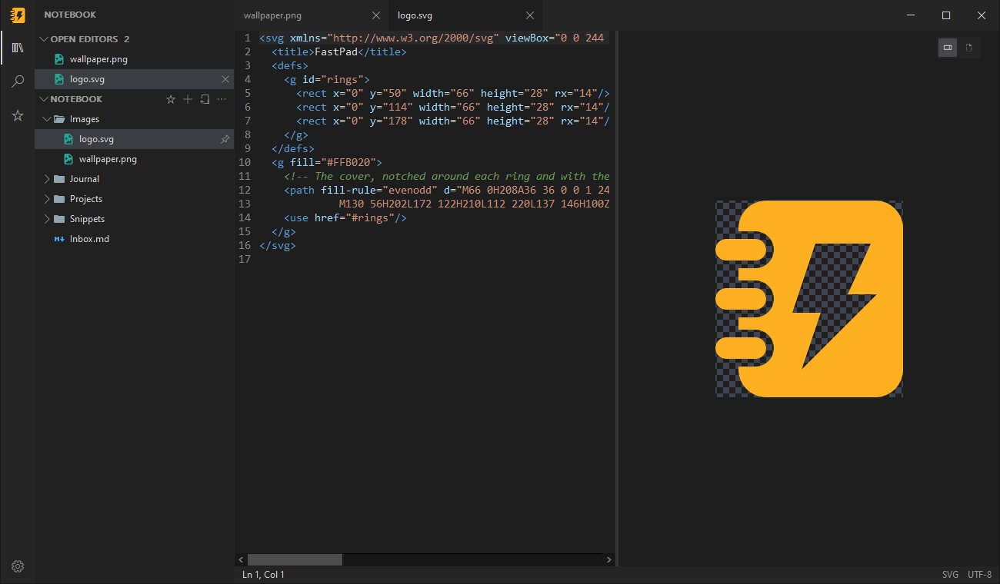
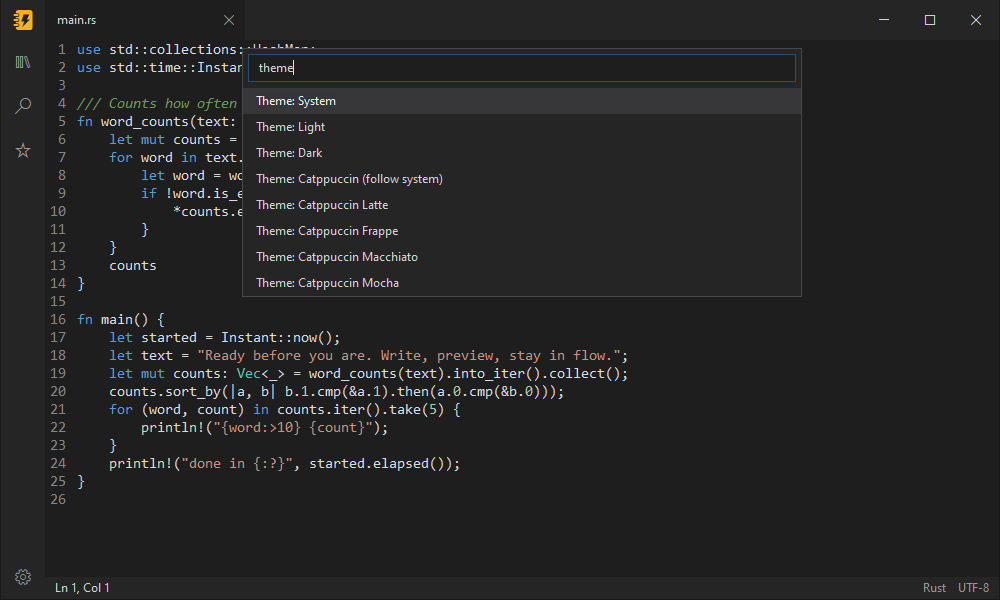
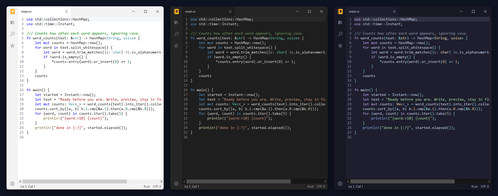

# FastPad features

Everything FastPad does, in detail. For a quick overview see the [README](../README.md).

## Markdown with a live preview



Write on the left, see it rendered on the right. FastPad draws GitHub-flavored Markdown natively
(tables, task lists, strikethrough, code blocks and local images) and updates moments after you stop
typing. Both panes scroll together.

- Each Markdown tab has a view: **Source**, **Live** (rendered as you type, below), **Split** (the
  source with the preview beside it; drag the divider to resize it) or **Preview** (full width).
  Pick one in the toolbar under the tabs (which also shows where the file lives) or View → Markdown
  view, or press `Ctrl+Shift+V` to cycle through them. Each tab keeps its own view, and Escape leaves Preview.
  SVG files get Source, Split and Preview.
- Select and copy text in the preview as in a browser: drag (it scrolls at the edges),
  double-click a word, triple-click a paragraph, Shift+click to extend, `Ctrl+A` for everything.
  `Ctrl+C` or right-click → Copy puts plain text on the clipboard, without Markdown markers,
  plus a formatted version, so pasting into Word or Outlook keeps headings, bold, links, lists
  and tables.
- Links just work: web links open in your browser, `#headings` jump inside the preview, and links to
  local files open in a new FastPad tab.
- Mermaid diagrams: a ```` ```mermaid ```` code block draws as a diagram (flowcharts, sequence,
  class, state, ER, pie, Gantt, journey, mindmap, timeline, Git graphs and more) in the preview's
  own colors and font. It renders in Rust on a worker thread, with no browser or JavaScript. While you
  edit, the last good diagram stays up, and a mistake shows its error above it. Copying a selection
  across a diagram copies its source. Live draws them too, and shows the source when you click in.
- Privacy by design: only local images are shown, and nothing is fetched from the internet.
- The preview's graphics stack loads the first time you open a preview, so it never slows startup.
- Writing helpers in Markdown files: `Ctrl+B`, `Ctrl+I`, ``Ctrl+` `` and `Ctrl+K` make the selection
  bold, italic, code or a link, and `Ctrl+Shift+X` strikes it through. `Ctrl+Shift+1`–`6` make the
  line a heading (`Ctrl+Shift+0` a paragraph again), `Ctrl+Shift+8` / `7` a bulleted / numbered list,
  and `Ctrl+Shift+9` a task, or ticks and unticks it. Enter continues a list or block quote (Enter on
  an empty item ends it) and renumbers the numbered items after it, and Enter after an opening code
  fence closes it. Tab and Shift+Tab nest list items and move between table cells, Tab in a table's
  last cell adds a row, a table lines up when you leave it, and Markdown: Insert table / Add table
  column / Delete table column build one from the command palette. Each is a single undo step.
- Typing in Markdown files: `(`, `[` and `` ` `` close themselves (and the closer is stepped over),
  Backspace in an empty pair removes both, and typing `*`, `_`, `~`, `` ` ``, `[` or `(` over a
  selection wraps it. A URL pasted over selected text makes it a link, and Home on a list item,
  quote or heading goes to its text first.
- Completion as you type: `[[` lists notes to link to, ranked like `Ctrl+P`; `#` and a letter lists
  the notebook's tags; and `/` at the start of a line lists commands (headings, lists, tasks, quote,
  code block, table, divider, link, image, callouts, date, time). The lists work in the Live view
  too.
- **Live Markdown (preview):** `Ctrl+Alt+V`, or View → Markdown view → Live, switches a Markdown
  tab to a view FastPad draws itself, in the preview's font with real wrapping. Typing, selecting, undo,
  find, the writing helpers and Japanese, Chinese or Korean input work as in the source view, and the
  file is only ever changed by what you type or a task checkbox you click. Headings, bold, italic,
  strike-through, inline code, links and `[[wikilinks]]` render in place with their markup hidden,
  and so do block elements: lists with bullets, numbers and clickable task checkboxes, quotes with
  their bars, rules, code blocks on a full-width background, tables as aligned grids, Mermaid
  blocks as their diagrams (or their code under the error, when one cannot be drawn) and local
  images as thumbnails (anything else shows its alt text; nothing is fetched). The block you are in
  (from blank line to blank line, a whole table or code block) shows its Markdown source, keeping
  its formatting and highlighted; front matter shows like a code block with its keys in bold, and
  raw HTML, footnotes and math are dimmed. Ctrl+click
  follows a link. Find and go to line reveal the block they land on, and switching to Split or
  Preview keeps your place. Right-click gives the usual edit menu plus Open link and
  Copy link address; dropped text lands where you drop it, and a selection can be dragged to move
  it (Ctrl+drag copies). Screen readers see it as editable text. Commands that need the source
  view's own features (multiple cursors, column selection, folding) switch back to it with a
  notice. To open Markdown tabs in it, pick **Live** under **Markdown view** in Settings (or set
  `markdown_view=live`). Tabs already open keep their view; the change applies to tabs you open
  next.

### What the preview renders

The preview renders GitHub-flavored Markdown natively (tables, task lists, strikethrough, code
blocks, images, bare `www.` and `https://` links and email addresses, and `> [!NOTE]`-style alerts)
and the HTML GitHub allows in READMEs: centred `<div>` and `<p>` blocks, sized
`` tags, `<picture>` images that follow the light or dark theme, collapsible
`<details>` sections, and inline tags such as `<kbd>`, `<sup>`, and `<br>`. Local PNG, JPEG, GIF,
and SVG images are shown; remote images show a placeholder with their alt text, because nothing is
loaded from the network. It updates shortly after you stop typing, and scrolling either pane scrolls
the other. Links open when clicked: web and mail links in your default browser, `#anchors` inside
the preview (opening any collapsed section around them), and local files in a FastPad tab.
Files larger than 10 MB pause live updates; click the bar at the top of the preview to refresh it.

## Notes and notebooks



Open any folder and it becomes a notebook: a tree in the sidebar, folders as they are on disk,
pinned notes first. Notes are plain files, so nothing is locked in. **File → New notebook…** names
a new folder and opens it as a notebook in one step.

The **+** at the top right of the Notebook view opens a notebook, creates one, or reopens a recent
one. Opening another notebook adds it to the sidebar instead of replacing the first. Each open notebook
is a collapsible root row of its own, and the sidebar button and tooltip read "*N* notebooks" once
several are open. Every root has its own `…` menu with **Close notebook** and **Add to
Favorites** (or **Remove from Favorites**); the other notebooks' menus also offer **Set as default
notebook**. New notes and folders go to
the notebook you're working in, otherwise the default one, and quick capture always uses the
default. Search, Replace in files, Quick Open and Tags cover every open notebook, and each result
names its notebook (`Work › projects`); the **All notebooks ▾** button in the Search view narrows a
search to one notebook. Wikilinks stay inside their own notebook.

Drag a note or folder onto any folder of another notebook to move it there (hold **Ctrl** to copy
instead); its open tabs, pin and expanded folders go with it. If the move would break wikilinks,
FastPad says how many first, and if the notes use images from the old notebook's attachments
folder it offers to bring them along (**Move with images**). A folder going to a notebook on
another drive is copied, checked, and only then sent to the Recycle Bin, with its progress and a
Cancel on its row. From the keyboard, **Note: Move to notebook…** (**`Ctrl+Shift+M`**) moves the
selected note or folder: pick the notebook, then a folder in it. FastPad reopens the same
notebooks next time (`folders.ini` keeps them as `open=` lines, with the default marked
`default=`). A notebook that isn't available at startup, such as one on an unplugged drive, is
skipped with a notice but stays remembered until its drive returns.

- **Write fast.** New notes are named inline and save themselves once they're in the notebook.
  Create, rename, move (drag and drop) and delete notes and folders right in the tree.
- **Find anything.** Search and replace across every note, with case, whole-word and regex
  options, and jump to any note by typing part of its name. Nothing is indexed; results stream in.
- **Open Editors** lists every open tab above the tree. Drag files in from Explorer or from Open
  Editors to copy them into the notebook.
- Star notebooks to keep them in **Favorites**, which highlights every open one and jumps to it in
  the tree when you click it.
- Pick coloured, minimal or solid file icons, and drive it all from the keyboard or a screen
  reader.

Pins travel with the notebook in `.fastpad\library.ini`, and nothing is written into a folder until
you pin something. Turn notes off with `notes_mode=false` in `fastpad.ini`.

## Tags and front matter

Tag a note with `#tags` anywhere in its text, or in its YAML front matter:

```markdown
---
tags: [project/atlas, todo]
status: active
---
Call Dana about the #budget.
```

- **The Tags view** (the tag button in the activity bar, or **View: Show tags**) lists every tag
  in every open notebook with how many notes use it. Nested tags like `#project/atlas` sit under
  `#project`. Expand a tag to see its notes; click one to open it.
- **In the preview**, front matter folds into a **Properties** panel (click it to see every
  property, with list values as chips), and each `#tag` is a chip
  you can click to see the tag's notes.
- Tags in code, links and HTML don't count, and neither do `#123` or `C#`.

FastPad keeps an index of every Markdown note's tags and front matter, updated as notes are saved
or changed outside FastPad, and cached so the next start reads only what changed.

## Links between notes

Link to another note by name with `[[wikilinks]]`, as Obsidian does:

```markdown
See [[Project Atlas]], its [[Project Atlas#Goals|goals]], or [[work/Plan]].
```

- **Type `[[`** and FastPad offers the notebook's notes; keep typing to narrow the list.
- **Follow a link** with `Ctrl+Click` or `F12` in the editor, or a click in the preview. A link to
  a note that doesn't exist yet creates it.
- A name finds a note by its file name, its path, or an `aliases:` entry in its front matter.
  When two notes share a name, the one in the linking note's folder wins.
- **The Links view** (the link button in the activity bar, or **View: Show links**) shows which
  notes link to the active note, with the line that mentions it, and what the note links to.
  It also lists **missing notes** (linked but not yet written) and notes nothing links to.
- **Rename or move a note** in FastPad and its relative links are fixed, and FastPad offers to
  update the links in other notes. Renaming can keep the old name as an alias. When another
  program renames a note, a notice says which links still use the old name, and
  **Notes: Update links to renamed notes** fixes them.

## Images and files in notes

In a Markdown note, **paste a screenshot** (`Ctrl+V`) or files copied in Explorer, or **drop files
with `Ctrl` held**, and FastPad copies them into the notebook's `attachments` folder (or the one
your Obsidian vault uses) and links them where the caret is: `` for images,
`[name](…)` for other files. **Notes: Insert attachment…** picks a file instead.

- When the clipboard has text too (a paragraph copied from Word puts a picture there as well),
  `Ctrl+V` pastes the text. **Notes: Paste image as attachment** takes the image anyway.
- A Markdown file outside the notebook keeps its attachments in an `attachments` folder beside it.
- Move a note and its links to images and files keep working. Move an image in the Notebook tree
  and FastPad offers to update the notes that show it.

## Daily notes and templates

- **`Ctrl+Alt+D`** (Notes: Open today's note) opens today's note in `journal\`, making it the
  first time from `.fastpad\templates\daily.md`, or with the date as its heading.
  **Notes: Previous daily note** and **Next daily note** step through the journal.
- **Notes: New note from template…** (also in the Notebook `…` menu and a folder's right-click
  menu) lists the templates in `.fastpad\templates` and makes a new note from the one you pick.
- Templates fill in `{{date}}`, `{{date:dddd, D MMMM YYYY}}`, `{{time}}` and `{{title}}`, and the
  caret starts at `{{cursor}}`. Placeholders work in front matter too.
- A notebook's conventions live in `.fastpad\notebook.ini`, which other tools and AI agents can
  read too. **Notes: Edit notebook settings** opens it:

```ini
daily_folder=journal
daily_format=YYYY-MM-DD
daily_template=.fastpad/templates/daily.md
templates_folder=.fastpad/templates
inbox=inbox.md
```

## Quick capture

Press **`Ctrl+Alt+N`** anywhere to jot something down without leaving what you're doing. The
capture box appends it to the default notebook's `inbox.md` (or wherever that notebook's
`capture_target` points) as a time-stamped list item.

- **`Ctrl+Enter`** saves and closes; **`Ctrl+Shift+Enter`** also opens the note. **`Esc`** closes
  and keeps what you typed for next time.
- **Images and files:** paste a screenshot or files copied in Explorer, drop files on the box, or
  press **`Ctrl+Shift+S`** to snip part of the screen with Windows' own tool. They are copied into
  the notebook's `attachments` folder and linked from the capture.
- **`Ctrl+Alt+N`** again in the box switches where this capture goes: the inbox, today's daily
  note, or a new file of its own in `inbox`, which suits AI agents that process items one by one.
  `capture_target` in `notebook.ini` sets the default.
- It works when FastPad isn't running too: the installer's "Quick capture shortcut" option sets
  up the same key, and `FastPad.exe --capture "text"` captures from scripts.

## Changes made outside FastPad

Edit a file in another program, sync it from another PC, or let an AI agent work on your notes:
FastPad keeps up while it's open.

- **Open tabs follow the file.** A tab with no unsaved edits picks up the new text as soon as
  the file changes, as one edit you can undo: **Ctrl+Z** brings back what you had.
- **Appends join your edits.** Text added to the end of a file you're editing (a log, an inbox)
  is added to the end of your tab, with nothing to resolve.
- **Real conflicts wait for you.** Any other change to a tab with unsaved edits shows a warning in
  the tab and pauses autosave. Use **Note: Reload from disk**, **Note: Keep my version**, or
  **Note: Compare with disk** to see the file's version read-only beside yours.
- **A deleted file keeps its tab**, marked "(deleted)". Saving creates it again.
- **The notebook shows what changed.** A dot marks each note changed outside FastPad since you
  last opened it, and it survives a restart. **Notes: Show changed notes** lists only those;
  **Notes: Clear changed marks** clears them.

Each open notebook is watched for changes as they happen, and other open files are checked when
FastPad comes back to the front. Changes inside folders such as `.git` and `node_modules` are
ignored. To have every change wait for you instead, set `reload_changed_files=ask`.

## JSON you can trust



Syntax highlighting as soon as you open a `.json` file. **Validate JSON** points to the exact line
and column of a mistake; **Format JSON** pretty-prints the whole document in one step you can undo. Neither will
touch a file that doesn't parse.

## Syntax highlighting for the files you actually open

FastPad picks the language from the file name and colours it in every theme: JSON, Markdown, XML
(including SVG, `.csproj` and `.xaml`), HTML, CSS, JavaScript, TypeScript, YAML, TOML, INI,
`.properties`, `.env`, PowerShell, Bash, Batch, Python, C, C++, C#, Rust and SQL. Switch it by hand
from **View → Language** or the command palette. The notebook lists all of these files too
(`.env`, `.bashrc` and `Cargo.lock` included), each with its own icon in every icon set.

## Tabs, done right

Open as many files as you like in one window. Every tab keeps its caret and scroll position, across
switches and restarts. Open a file from Explorer or the command line and it lands as a tab in the
FastPad window you already have open, not in a new window.

## Split editors



Put files side by side in any grid of rows and columns. Drag a tab onto another group to move it,
or onto an editor's edge to split it. Each group has its own tabs, and the layout comes back with
your session.

## Images next to your notes



PNG, JPEG, GIF, WebP and more open in an image tab you can zoom and pan. SVGs open as text, with
their rendered preview beside the source. The notebook lists images next to your notes.

## A command palette for everything



Open it and start typing. Switch theme, toggle word wrap or line numbers, change font size
or tab width, all without leaving the keyboard. Every change is saved instantly. Prefer to
see everything at once? **Settings** (`Ctrl+,`, **File > Settings...** or the gear at the
bottom of the sidebar) lists every setting, and changes apply as you make them.

## Themes that match your desk



Light, dark, or **System** to follow Windows as it switches. Plus all four
[Catppuccin](https://catppuccin.com/) flavors (Latte, Frappé, Macchiato, Mocha), or plain
`catppuccin` to pick Latte by day and Mocha by night. For long reading and writing sessions there are
**Paper** (warm off-white) and **Lamp** (warm charcoal), or `paper-lamp` to pick Paper by day and Lamp by
night. Windows high contrast is always respected.

## Crash recovery that just works

FastPad quietly snapshots unsaved documents every 30 seconds while you edit. If your PC crashes,
loses power or reboots for an update, the next launch brings your work back as unsaved tabs. Saving
or discarding a recovered tab cleans up after itself.

## Pick up where you left off

Close FastPad and the next launch reopens every tab, including unsaved edits and untitled notes,
with the tab you were on active. Closing never nags about unsaved changes while this is on. Turn
it off with **File > Restore session on startup** or `restore_session=false`, and FastPad asks
before closing again.

## And the details you'd expect

- **Safe saves.** Files are written to a temporary copy and swapped into place, so a failed save never
  leaves you with a half-written file.
- **Encodings preserved.** UTF-8, UTF-8 with BOM, UTF-16 LE and UTF-16 BE are detected on open and
  kept on save.
- **Find and replace** with match case, whole word and regular expressions, plus zoom, word wrap
  and line numbers.
- **Code folding.** Collapse and expand blocks from the margin, or with Fold All and Unfold All in
  the command palette. Turn it off in Settings.
- **Screen-reader friendly links.** Links in the Markdown preview are exposed to assistive
  technology and can be followed from it.
